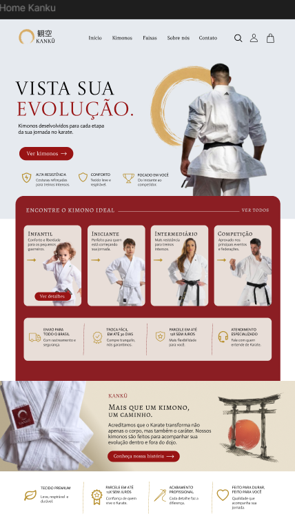
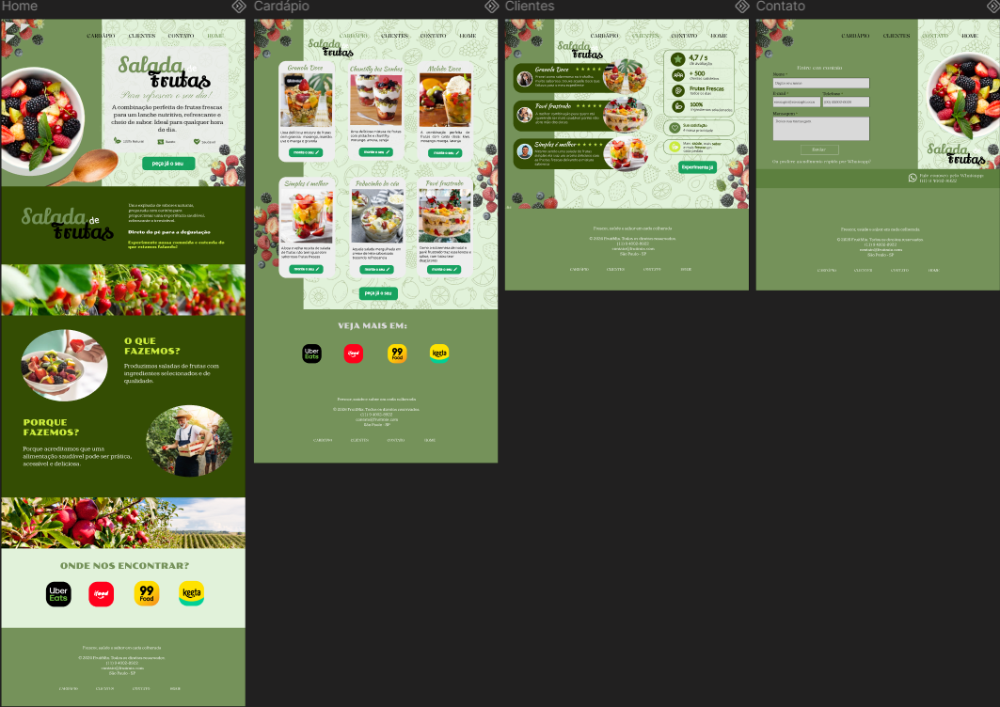
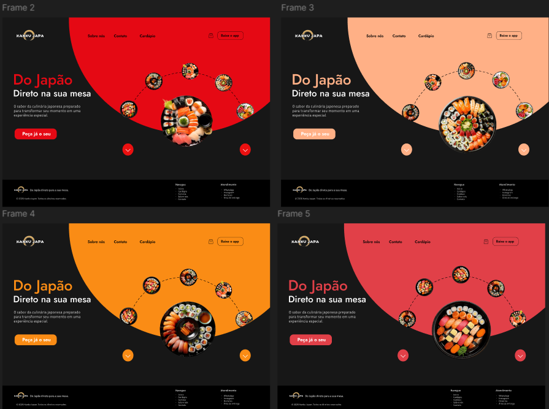
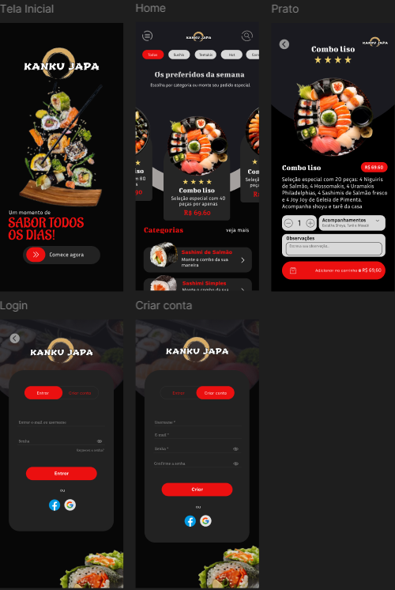

# Estudos-Web-Design
Atividades de prototipagem de landing page, site, e sistemas em ui/ux. visando conhecimento com as ferramentas do figma, edição e criação de conteúdos visuais. >>> Pelo prof° Jailson Costa por instituto PROA

# Projetos Figma

## Sobre

Este repositório reúne projetos desenvolvidos durante meus estudos e práticas de UI/UX Design utilizando o Figma.

Os projetos foram criados como exercícios de aprendizagem, com foco na prática de conceitos de design de interfaces, organização visual, prototipação e estruturação de diferentes tipos de telas e experiências digitais.

## Projetos

### Projeto 01

---

### Projeto 02

---

### Projeto 03

---

### Projeto 04

---

### Projeto 05

---

### Projeto 06

---

### Projeto 07

---

### Projeto 08

---

### Projeto 09

---

### Projeto 10

## Objetivo

O objetivo deste repositório é documentar minha prática e evolução no desenvolvimento de interfaces digitais, reunindo projetos realizados como exercícios e estudos no Figma.

## Ferramenta

- Figma

## Observação

Os projetos apresentados neste repositório foram desenvolvidos para fins de estudo e aprendizagem. Portanto, não representam necessariamente produtos ou soluções comerciais.
